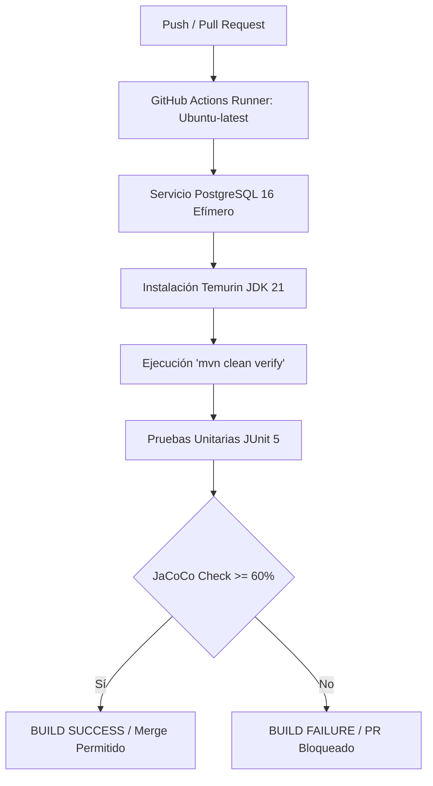

# 🛠️ TI-Desk — Sistema de Mesa de Ayuda ITIL 4

[](https://github.com/ti-desk/ti-desk/actions/workflows/ci.yml)
[](https://github.com/ti-desk/ti-desk)
[](https://www.oracle.com/java/)
[](https://spring.io/projects/spring-boot)
[](https://www.postgresql.org/)
[]()

**TI-Desk** es una solución web empresarial de gestión de servicios e incidentes de Tecnologías de la Información (ITIL 4) diseñada para el entorno universitario. El sistema automatiza el ciclo de vida completo de la atención a solicitudes, gestión de inventario de activos, acuerdos de nivel de servicio (SLA) y análisis de métricas operativas.

---

## 👥 Equipo de Ingeniería y Roles

| Integrante | Rol Principal | Responsabilidad Clave |
| :--- | :--- | :--- |
| **Profesor** | Product Owner / Evaluador | Definición de visión, evaluación y priorización de entregables |
| **Yahir Antonio Bautista Ramirez** | DevOps / SRE Lead | Infraestructura, CI/CD, Docker, JaCoCo Quality Gates y Métricas |
| **Fernando** | Project Manager / Scrum Master | Gestión del proyecto, Sprints y eliminación de impedimentos |
| **Melisa** | Product Owner / Analista | Definición de historias de usuario, SRS y criterios de aceptación |
| **Sashi** | Lead Architect / Security Lead | Arquitectura de software, autenticación y seguridad JWT |
| **Ulises** | Backend / DBA Lead | Modelado de datos, JPA Hibernate y migraciones Flyway |
| **Brenda** | QA / Test Lead | Estrategia de pruebas, control de calidad y verificación |

---

## 🚀 Stack Tecnológico

- **Lenguaje & Framework:** Java 21 LTS, Spring Boot 3.x (Spring Web, Spring Security, Spring Data JPA).
- **Base de Datos:** PostgreSQL 16 con migraciones automatizadas vía **Flyway**.
- **Contenerización & Entorno Local:** Docker & Docker Compose (PostgreSQL 16, Mailpit SMTP).
- **Integración Continua (CI):** GitHub Actions (`ci.yml` ejecutado en runners de Ubuntu).
- **Calidad de Código & Testing:** JUnit 5, Mockito, **JaCoCo 0.8.12** (Quality Gate obligatorio al 60% de cobertura).
- **Herramientas de Soporte:** Mailpit (servidor SMTP simulado para envío de correos).

---

## ⚡ Guía de Inicio Rápido (Quickstart)

### Requisitos Previos
Asegúrate de tener instalados los siguientes componentes en tu máquina local:
- **JDK 21** o superior (Eclipse Temurin recomendado).
- **Apache Maven 3.8+** (o el wrapper `./mvnw` incluido).
- **Docker** & **Docker Desktop / Engine** activo.
- **Git**.

### 1. Clonar el Repositorio
```bash
git clone https://github.com/ti-desk/ti-desk.git
cd ti-desk
```

### 2. Levantar Servicios de Soporte (Base de Datos y Mailpit)
Ejecuta Docker Compose para inicializar el contenedor de PostgreSQL 16 y el servidor SMTP Mailpit:
```bash
docker compose up -d
```
*Verifica que los servicios estén activos:*
- **PostgreSQL 16:** `localhost:5432` (BD: `tidesk_db`, Usuario: `postgres`, Password: `postgres`)
- **Mailpit Web UI:** `http://localhost:8025`

### 3. Compilar, Probar y Verificar Quality Gate Local
Ejecuta la fase de verificación completa de Maven para correr las pruebas unitarias y evaluar el umbral de cobertura de JaCoCo:
```bash
mvn clean verify
```
Si la cobertura de líneas es igual o superior al **60%**, obtendrás la confirmación **`BUILD SUCCESS`** y el reporte detallado se generará en:
`target/site/jacoco/index.html`

### 4. Ejecutar la Aplicación en Local
```bash
mvn spring-boot:run
```
La API estará disponible en `http://localhost:8080`.

---

## 📐 Estrategia de Trabajo y Gobernanza Git

Para garantizar la estabilidad del código en todo momento, el equipo trabaja bajo el modelo **Trunk-Based Development** adaptado a un monorepo protegido:

### Reglas para Pull Requests (PR):
1. **Ramas derivadas de `main`:** Nombradas siguiendo el patrón `feature/TID-XX-descripcion-corta` o `fix/TID-XX-descripcion-corta`.
2. **Conventional Commits:** Todos los commits deben llevar prefijos estandarizados:
   - `feat(TID-XX): ...` -> Nuevas funcionalidades.
   - `fix(TID-XX): ...` -> Corrección de errores.
   - `test(TID-XX): ...` -> Pruebas unitarias o de integración.
   - `ci(TID-XX): ...` -> Ajustes en GitHub Actions, Docker o JaCoCo.
   - `docs(TID-XX): ...` -> Documentación del repositorio.
3. **Revisiones Obligatorias por Dominio:**
   - **Pipeline / Docker / CI:** Revisor obligatorio `@Yahir`
   - **Seguridad / JWT:** Revisor obligatorio `@Sashi`
   - **Base de Datos / Flyway:** Revisor obligatorio `@Ulises`
   - **Negocio / Servicios:** Revisor obligatorio `@Brenda` (QA)
4. **Prohibición de Self-Merge:** Ningún desarrollador puede aprobar o integrar su propio Pull Request a `main`.

---

## 📊 Integración Continua y Quality Gates

El workflow de CI en GitHub Actions se activa automáticamente ante cada `push` o `pull_request` enviado a la rama `main`:



---

## 📄 Licencia y Propiedad
Proyecto desarrollado para el proyecto integrador del programa académico de la licenciatura en Informatica en la Universidad del Istmo (UNISTMO). Todos los derechos reservados © 2026 **TI-Desk Team**.