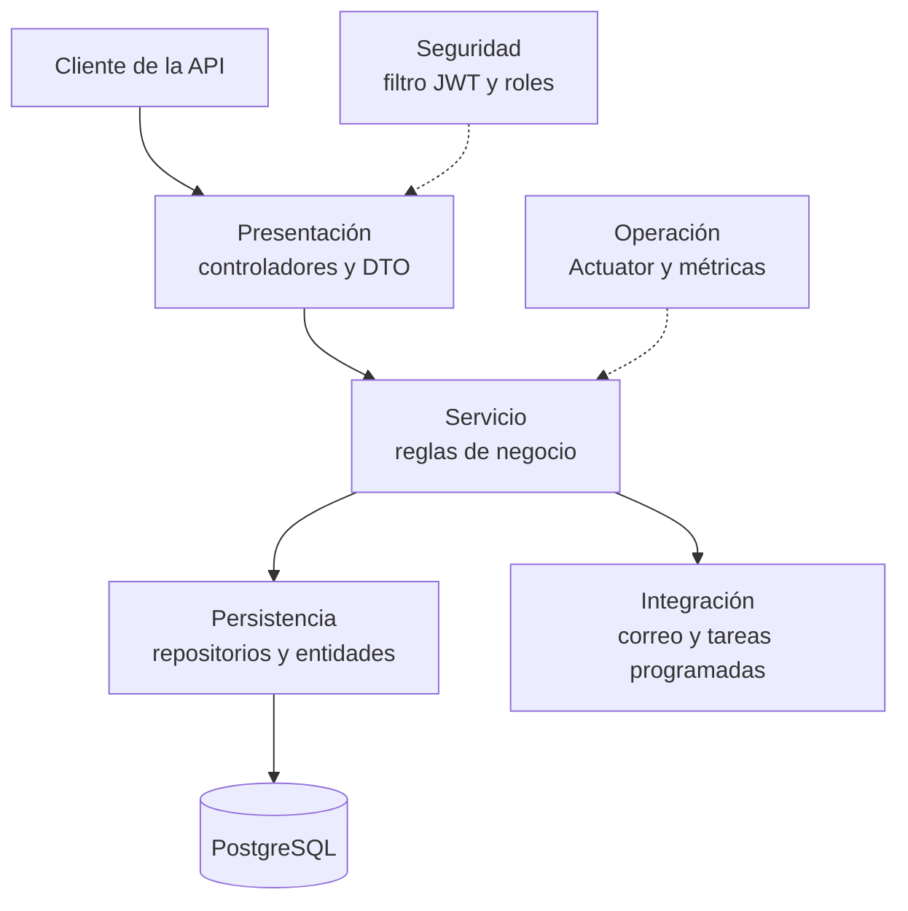
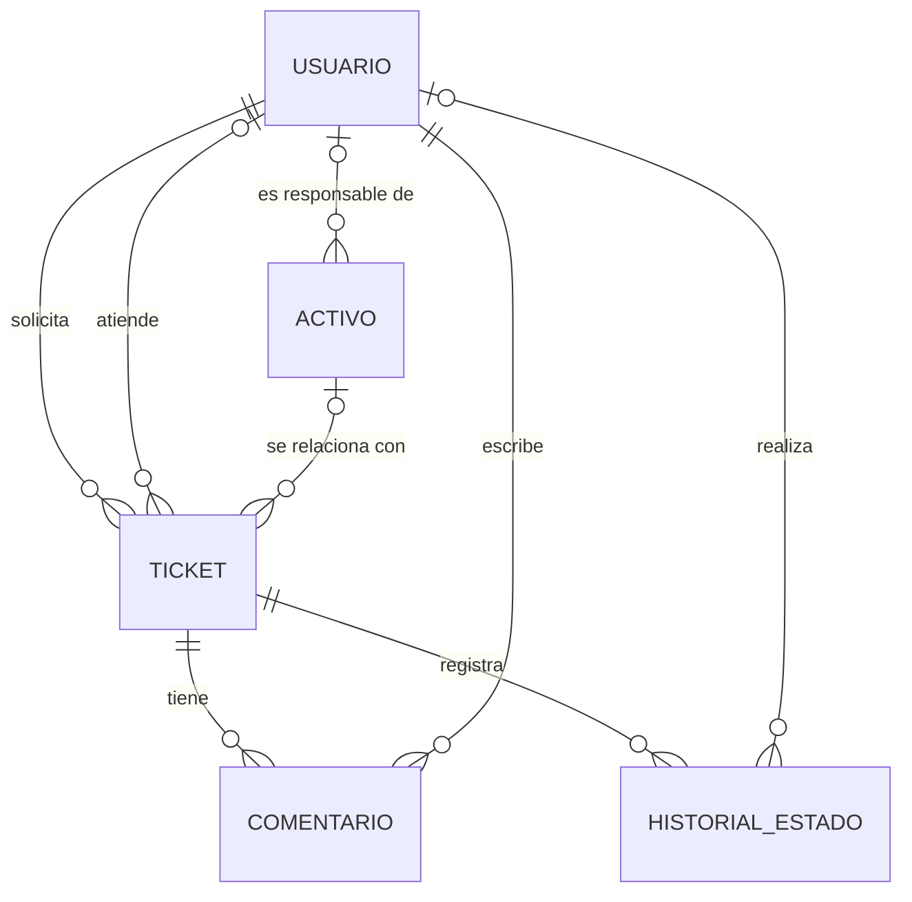
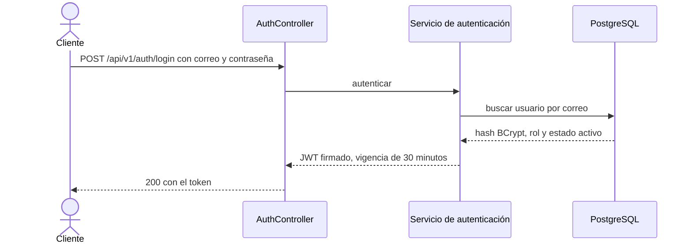
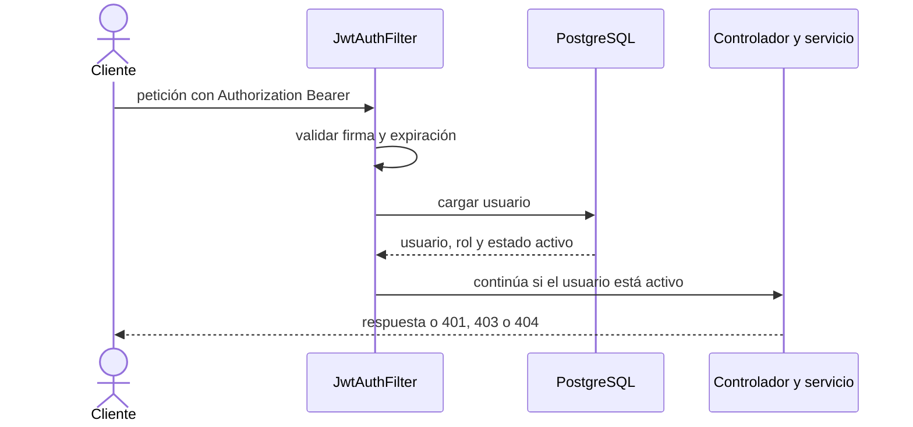
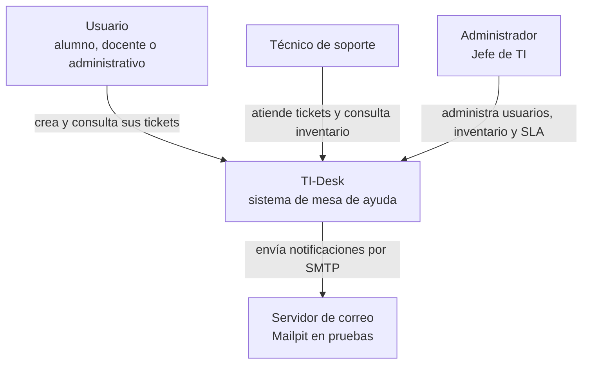
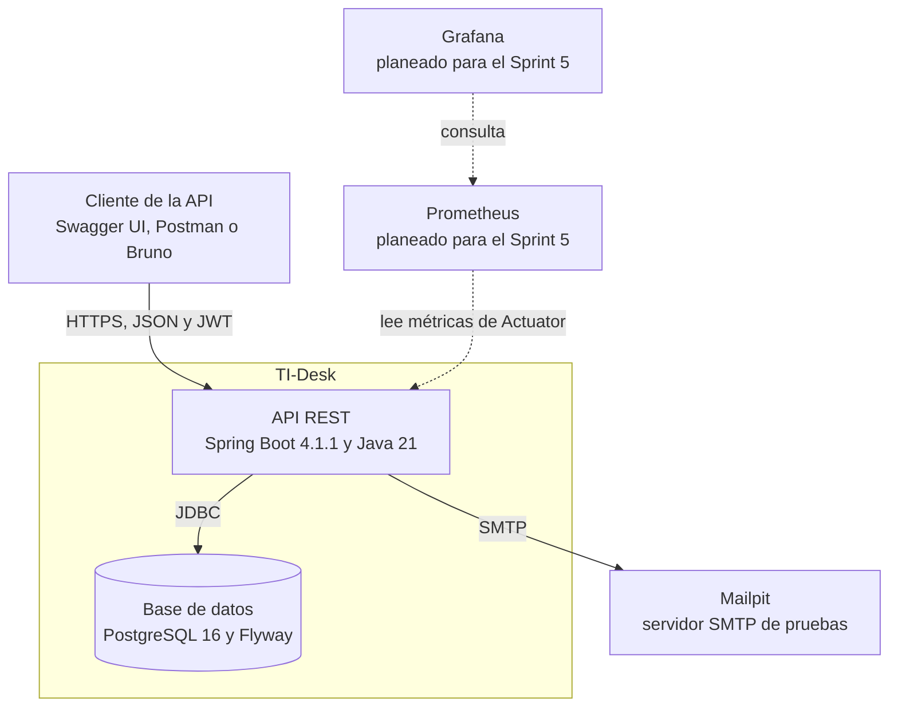

# Documento de arquitectura de TI-Desk

- **Versión:** 0.1 (avance para el parcial)
- **Fecha:** 22 de octubre de 2026
- **Responsable:** Sashid Blanco Garrido (Arquitecto(a) de software / Líder técnico)

## 1. Propósito

Este documento explica cómo se construye TI-Desk y por qué. Reúne la metodología de trabajo, la arquitectura en capas, la estructura de paquetes, el modelo de datos, el enfoque de seguridad y las vistas C4. Las decisiones puntuales están registradas en los ADR de la carpeta `docs/adr`.

## 2. Contexto del sistema

Hoy las solicitudes de soporte al área de TI de la universidad llegan por canales informales (mensajes, llamadas, peticiones en persona), sin folio, sin prioridades, sin tiempos de atención y sin indicadores. TI-Desk es una API REST de mesa de ayuda basada en prácticas de ITIL 4 que ordena ese proceso: tickets con ciclo de vida e historial, niveles de servicio (SLA), inventario de activos, notificaciones por correo e indicadores.

Usuarios del sistema:

| Rol | Qué hace |
|-----|----------|
| USUARIO | Crea tickets y consulta solo los propios (alumno, docente o administrativo) |
| TECNICO | Atiende tickets, comenta y consulta el inventario |
| ADMIN | Acceso total: asigna, administra usuarios, inventario y políticas de SLA, y ve el dashboard |

## 3. Metodología de trabajo

El anteproyecto del proyecto define el marco de trabajo; la arquitectura lo adopta y lo hace cumplir con revisiones de código, pruebas automáticas y ADR. Esto es lo que se usa y por qué:

| Práctica | En qué consiste | Por qué se adopta |
|----------|-----------------|-------------------|
| Scrum con sprints de 2 semanas | Planning, daily asíncrona, review y retrospectiva; backlog priorizado con MoSCoW | Entrega incrementos demostrables cada 2 semanas y permite corregir el rumbo. Encaja con 16 semanas y un equipo de 6 personas con roles definidos |
| Desarrollo basado en tronco (trunk-based) | Ramas cortas de máximo 3 días que salen de `main` y vuelven por Pull Request | Evita la integración tardía ("big bang"), un riesgo de probabilidad alta identificado en el anteproyecto |
| Pull Request con revisión obligatoria | Nadie integra su propio código; cada dominio tiene un revisor (seguridad, pipeline, base de datos, negocio) | Mejora la calidad y reparte el conocimiento del código |
| Conventional Commits con ID de historia | Mensajes como `feat(TID-04): ...` | Permite rastrear cada cambio hasta su historia y su requisito |
| Integración continua con quality gates | GitHub Actions ejecuta compilación, pruebas y JaCoCo; el build falla si la cobertura baja de 60 % | Detecta errores en cada cambio, antes de llegar a `main` |
| ADR (registros de decisión) | Una página por decisión con contexto, alternativas y consecuencias | Deja constancia de por qué se decidió algo, para poder explicarlo y revisarlo |
| ITIL 4 como marco del dominio | Gestión de incidentes, solicitudes de servicio y niveles de servicio | Es el estándar de gestión de servicios de TI y define qué debe hacer el sistema |

## 4. Decisiones de arquitectura (ADR)

| ADR | Decisión |
|-----|----------|
| [ADR-001](adr/ADR-001-version-spring-boot.md) | Java 21 y Spring Boot 4.1.1 |
| [ADR-002](adr/ADR-002-arquitectura-en-capas.md) | Arquitectura en capas con DTO |
| [ADR-003](adr/ADR-003-autenticacion-jwt.md) | Autenticación stateless con JWT, BCrypt y autorización por rol y propiedad |

## 5. Arquitectura en capas

### 5.1 Las capas

| Capa | Responsabilidad | Componentes |
|------|-----------------|-------------|
| Presentación | Recibir peticiones HTTP, validar la entrada, convertir a DTO y devolver el código de estado correcto | `@RestController`, Bean Validation, `@RestControllerAdvice` |
| Seguridad (transversal) | Autenticar el JWT y autorizar por rol | `SecurityFilterChain`, filtro JWT, `@PreAuthorize` |
| Servicio (dominio) | Reglas de negocio, transacciones, control de propiedad | `@Service`, `@Transactional` |
| Persistencia | Acceso a datos | Spring Data JPA, Flyway, PostgreSQL |
| Integración | Correo y tareas programadas | `JavaMailSender`, `@Scheduled` |
| Operación | Salud y métricas | Actuator, Micrometer, Prometheus |



### 5.2 Reglas obligatorias

1. Ninguna capa se salta a la de abajo: los controladores llaman a servicios y los servicios llaman a repositorios.
2. Los controladores **nunca** acceden a repositorios.
3. Las entidades JPA **nunca salen de la capa de servicio**; hacia afuera solo se exponen DTO.
4. Las transacciones se declaran en la capa de servicio.
5. Los errores se devuelven en formato ProblemDetail (RFC 9457): 409 para transiciones de estado inválidas y 404 cuando el recurso no existe o está oculto para el rol.

### 5.3 Por qué esta arquitectura

- **Trabajo en paralelo:** seis personas desarrollan módulos distintos; las capas dejan claro dónde va cada cosa y reducen los conflictos.
- **Pruebas:** los servicios se prueban de forma aislada, sin levantar la web ni la base de datos.
- **Seguridad:** al exponer solo DTO, un campo interno como `password_hash` no puede filtrarse por accidente, y el contrato de la API no queda atado al esquema de la base de datos.
- **Verificación:** las reglas 2 y 3 se comprueban con pruebas de arquitectura (ArchUnit) en el pipeline y con la revisión de los Pull Requests.

Alternativa descartada: arquitectura hexagonal. Desacopla más, pero añade clases y complejidad que un equipo de 6 personas no puede absorber en 16 semanas (ver ADR-002).

## 6. Estructura de paquetes

La organización es **por funcionalidad** bajo `mx.edu.tidesk`, y dentro de cada paquete se respeta la separación en capas:

```
mx.edu.tidesk
├── config/        // SecurityConfig, OpenApiConfig, ClockConfig
├── seguridad/     // JwtService, JwtAuthFilter, AuthController
├── usuario/       // Usuario, UsuarioRepository, UsuarioService, UsuarioController, dto/
├── ticket/        // Ticket, EstadoTicket, TicketService, TicketController, dto/
├── comentario/
├── activo/        // Activo, ActivoService, ActivoController
├── sla/           // PoliticaSla, CalculadoraSla, RevisorSlaJob
├── notificacion/  // NotificacionListener, PlantillasCorreo
├── indicador/     // DashboardService, MetricasNegocio
└── comun/         // manejo de errores (ProblemDetail), auditoría, utilidades
```

Por qué por funcionalidad y no por capa técnica: cada integrante es dueño de un módulo (seguridad, tickets, SLA, inventario, indicadores). Con esta estructura, el trabajo de cada persona vive en su propia carpeta y los Pull Requests tocan pocos archivos de otros.

Convenciones de nombres: sufijos `Controller`, `Service` y `Repository`; los DTO viven en el subpaquete `dto` de cada funcionalidad.

## 7. Modelo de datos

El modelo lo diseña Ulises (Administrador de BD) y Arquitectura valida que encaje con la arquitectura. Se implementa con migraciones versionadas de Flyway sobre PostgreSQL 16.



Además de estas relaciones existen `politica_sla` (tiempos de respuesta y resolución por prioridad, configurables sin tocar el código) y `folio_secuencia` (consecutivo anual para generar el folio TID-AAAA-NNNNN).

Decisiones del modelo:

- **Fechas en UTC** (`timestamptz`), presentadas en la zona America/Mexico_City.
- **Bloqueo optimista** con la columna `version` en `ticket`: evita que dos técnicos asignen el mismo ticket a la vez.
- **Restricciones CHECK** en roles, estados, prioridades, categorías y tipos de activo: la base de datos rechaza valores inválidos aunque falle una validación en el código.
- **Índices** en las consultas frecuentes: estado y prioridad, técnico, fecha límite de SLA, solicitante y activo.
- **Migraciones versionadas:** todo cambio de esquema es una migración nueva; nunca se edita una ya integrada en `main`.
- **Historial de estados:** cada cambio de estado queda registrado con su autor (vacío cuando lo hace el sistema).

## 8. Seguridad

### 8.1 Roles y permisos

| Rol | Permisos |
|-----|----------|
| USUARIO | Crea tickets, ve y comenta solo los propios, confirma el cierre |
| TECNICO | Ve tickets sin asignar y los asignados a sí mismo, comenta (también de forma interna), cambia estados, consulta inventario |
| ADMIN | Acceso total, administra usuarios, inventario y políticas de SLA, ve el dashboard |

### 8.2 Flujo de autenticación





### 8.3 Por qué JWT sin estado y qué se pierde

- **Por qué:** una API REST sin sesiones en el servidor es más simple de probar y de escalar, y no depende de la infraestructura de la universidad (a diferencia de un inicio de sesión institucional con OAuth2/SSO, que está fuera del alcance obligatorio).
- **Qué se pierde:** la invalidación inmediata que ofrecen las sesiones, ya que un token firmado sigue siendo válido hasta que expira; y la comodidad de los tokens de refresco, que no se implementan (hay que iniciar sesión de nuevo cada 30 minutos).
- **Cómo se compensa:** el token solo lleva el identificador del usuario y la expiración. En cada petición el filtro carga al usuario desde la base de datos y rechaza la petición si está desactivado. Por eso desactivar una cuenta o cambiar un rol surte efecto en la siguiente petición, sin lista negra de tokens.

### 8.4 Control de propiedad (prevención de IDOR)

Revisar el rol no basta: un usuario no debe poder ver el ticket de otra persona cambiando el número en la URL. La capa de servicio verifica la propiedad antes de devolver cualquier recurso (USUARIO solo ve los suyos; TECNICO, los no asignados y los propios; ADMIN, todos). Si el recurso existe pero no corresponde al rol, la API responde 404 para no revelar que existe.

### 8.5 Manejo de secretos y otras medidas

- La clave del JWT y las contraseñas viven en variables de entorno o en GitHub Secrets; nunca en el repositorio.
- Contraseñas con BCrypt; solo se guarda el hash.
- Escaneo de secretos y de dependencias en el pipeline (Dependabot).
- Pruebas de seguridad: cada endpoint tiene un caso de acceso permitido y otro denegado.
- Checklist OWASP API Security Top 10 firmado en cada versión (v0.5.0 y v1.0.0).

## 9. Vistas C4

### 9.1 Nivel 1: contexto del sistema



### 9.2 Nivel 2: contenedores



El nivel 3 (componentes internos) se agrega en los siguientes sprints, conforme se construyen los módulos.

## 10. Estado al 22 de octubre de 2026

| Elemento | Estado |
|----------|--------|
| Proyecto base (Java 21, Spring Boot 4.1.1, Docker Compose, CI con JaCoCo) | Hecho |
| ADR-001, ADR-002 y ADR-003 | En revisión (Pull Request abierto) |
| Migraciones Flyway V1 y V2 (modelo de datos) | En revisión |
| Documento de arquitectura y vistas C4 de nivel 1 y 2 | Este documento |
| Renombrar el paquete base a `mx.edu.tidesk` | Pendiente |
| Módulo de seguridad (registro, login, JWT, roles) | Sprint 1, en desarrollo |
| Checklist OWASP firmado | Pendiente (v0.5.0) |