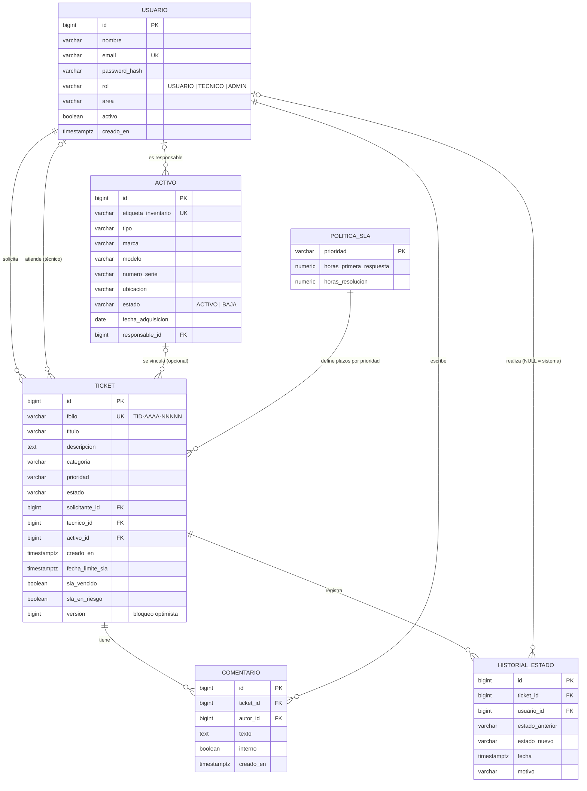

# Diagrama entidad-relación — TI-Desk

Responsable: Ulises. Se visualiza directo en GitHub (Mermaid). Detalle de columnas en `diccionario-de-datos.md`.

## Enumeraciones
- **Categoría:** RED, CORREO, EQUIPO, SOFTWARE, ACCESOS, OTRO
- **Prioridad:** CRITICA, ALTA, MEDIA, BAJA
- **Estado del ticket:** ABIERTO, ASIGNADO, EN_PROCESO, EN_ESPERA, RESUELTO, CERRADO, CANCELADO
- **Rol:** USUARIO, TECNICO, ADMIN
- **Tipo de activo:** LAPTOP, ESCRITORIO, IMPRESORA, SWITCH, ACCESS_POINT, PROYECTOR, OTRO

## Transiciones permitidas del ticket (se implementan en Sprint 2, RF-08)
- ABIERTO → ASIGNADO, CANCELADO
- ASIGNADO → EN_PROCESO, CANCELADO
- EN_PROCESO → EN_ESPERA, RESUELTO
- EN_ESPERA → EN_PROCESO
- RESUELTO → CERRADO, EN_PROCESO
- CERRADO y CANCELADO son estados finales
